# V1 验收报告

- 日期：2026-11-12
- 页面：`http://192.168.10.104:8088/`
- 分支：`main`
- 提交：`7b603c5`
- 结论：`READY_FOR_USER_TRIAL`
- 依据：1024 文生图、2048 文生图、文生视频、图生视频、首末帧视频都在这次页面操作里完成，预览可见，下载链接返回对应文件。刷新页面后这五条仍在。

这次记录只采用本次在内置浏览器里重新走完的流程和当时截下的页面。早先聊天里的页面截图和服务器日志截图不作为验收证据。

截图目录：`docs/acceptance/2026-11-12/`。

## 自动化 / mock

在仓库根目录、Python 3.10.9 下实际执行：

```bash
.venv/bin/python check_workflows.py
.venv/bin/python -m unittest discover -s tests -t .
```

结果：

- `check_workflows.py`：`t2v`、`i2v`、`flf`、`t2i_1mp`、`t2i_4mp` 全部 OK。
- `unittest`：15 项。2026-11-11 为 `Ran 15 tests in 2.160s`，`OK`。视频改走 8189 之后，2026-11-12 再跑仍是 15 项 `OK`，用时 1.644 秒。
- 覆盖迁移与旧行保留、运行中任务的选择性恢复、路径穿越、视频契约样例、未知状态、超时不重提、图片 history / `/view`、workflow 标记、旧 `/api/tasks` 与 `/api/v1` 共用一张表、健康检查，以及对本机 mock 8089/8190 的图片两档和视频 T2V / I2V / FLF 往返。
- mock 往返里，重启后的 Studio 仍能读到已完成图片。

这些通过不等于 104 真生成通过。104 的结论以下面的页面记录为准。

另外在本机用 mock 的 8089/8190 打开了 `http://127.0.0.1:8099`，实际点过页面：切到图片并选择 2048×2048 后，结果卡片出现预览和“下载图片”；切到视频后历史仍在，图生视频出现单张上传，文生视频提交后出现播放器和“下载视频”；刷新后两条记录都还在；首末帧同时显示首帧和末帧上传。播放器里的 0:00 来自 mock 字节，不是 104 上的真实 MP4。

## 104 只读证据

| 检查 | 结果 |
|---|---|
| `192.168.10.104:8089/openapi.json` | 200，标题为本地 H3 Native V2，`paths` 为空 |
| 未带密钥访问 `/v2/health` 与视频路由 | 401，`authorized_error` / `Invalid or missing API key` |
| SSH 读取 104 上的 Native API 源码 | 失败，公钥认证被拒绝 |
| `192.168.10.104:8190/system_stats` | 200，ComfyUI 0.45.0 |
| `8190/history` 与 `/view` | 读到已成功的 1024 和 2048 输出 |
| `8190/object_info/<class>` | workflow 中的 class 均存在 |

本次生成期间页头一直是「图片在线 · 视频在线」。图片走 `comfyui_h3_image`，视频走 `comfyui_h3_video`。没有重启 8089、8189、8190。

## 真实验收矩阵

| ID | 项目 | 结果 |
|---|---|---|
| RT-01 | Video Native API 可认证 | NOT RUN。页面视频不调用 8089 |
| RT-02 | Image `/system_stats` | 只读成功；本次健康检查为在线 |
| RT-03 | Video T2V | **PASS**，2026-11-12 10:48–10:53 |
| RT-04 | Video I2V | **PASS**，2026-11-12 10:54–10:59 |
| RT-05 | Video FLF | **PASS**，2026-11-12 11:00–11:04 |
| RT-06 | Image 1024×1024 | **PASS**，2026-11-12 10:46–10:47 |
| RT-07 | Image 2048×2048 | **PASS**，2026-11-12 10:48–10:49 |
| RT-08 | 刷新后历史仍在 | **PASS**，刷新后五条验收任务都还在 |
| RT-09 | 重启 Studio 后素材仍在 | NOT RUN。这次只刷新了页面，没有重启进程 |
| RT-10 | 图片/视频队列隔离 | **PASS**，2048 与文生视频同时处于生成中 |

## 2026-11-12 页面记录

操作都在已打开的 `http://192.168.10.104:8088/` 上完成。每条都只提交一次。图生视频和首末帧的参考图，是刚生成的两张验收图片，放进页面自己的文件框后由页面表单提交。时间取页面卡片和接口时间，时区为 UTC+8。

下载按钮都点过，页面仍停在 8088。同时用对应素材地址带 `download=1` 取回文件，响应为 `200`，`Content-Disposition` 为 `attachment`。

### RT-06 文生图 1024×1024

- 任务：`2ec4089523da4a05919a091a50ad3f28`
- 时间：10:46:39 提交，10:47:16 完成，约 37 秒。
- 提示词：验收静物：一只青色陶瓷茶杯放在木桌上，杯口有淡淡热气，窗外是晴朗的远山，自然光，方形构图。
- 结果：PNG，1024×1024，1,359,743 字节。素材 `94e5658ff69b4546ada4b67353af3186`。页面预览的原始尺寸也是 1024×1024。卡片为「图片生成完成 / 已完成」，标注 `1024x1024`，有「下载图片」。
- 提交前：


- 完成后：

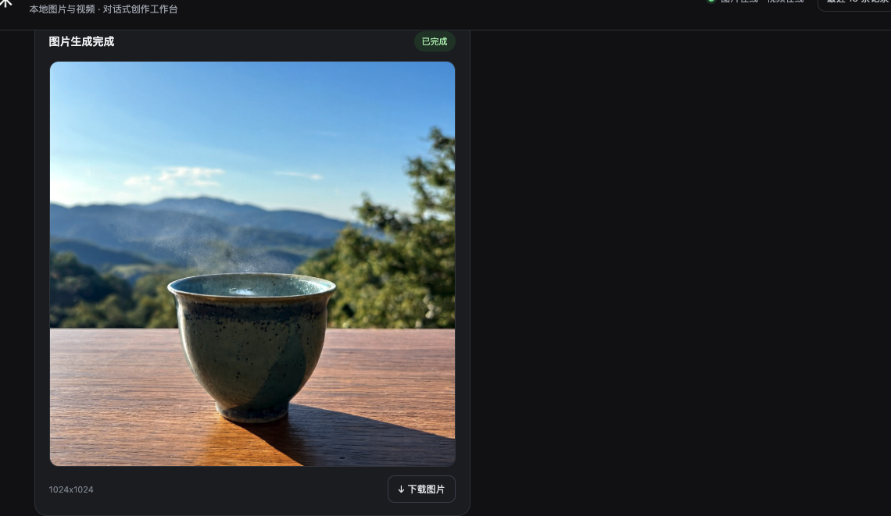

### RT-07 文生图 2048×2048

- 任务：`6dada36a8ec34f2e9699ec4e36b40077`
- 时间：10:48:14 提交，10:49:33 完成，约 79 秒。
- 提示词：验收静物：一本打开的素描本和一支铅笔放在窗边木桌上，暖色自然光，方形构图。
- 结果：PNG，2048×2048，6,238,108 字节。素材 `5dfb4a7c2af742e384692a50e698f08c`。页面预览的原始尺寸也是 2048×2048。卡片标注 `2048x2048`，有「下载图片」。
- 提交前，页头为「图片在线 · 视频在线」：

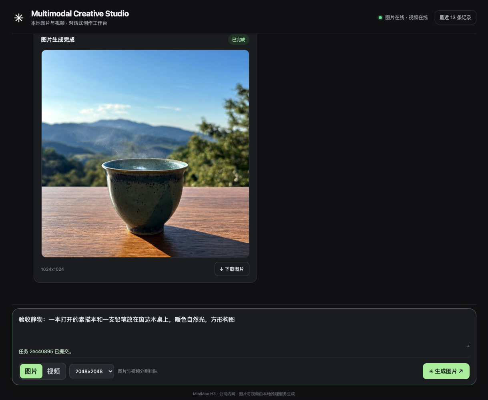

- 完成后：

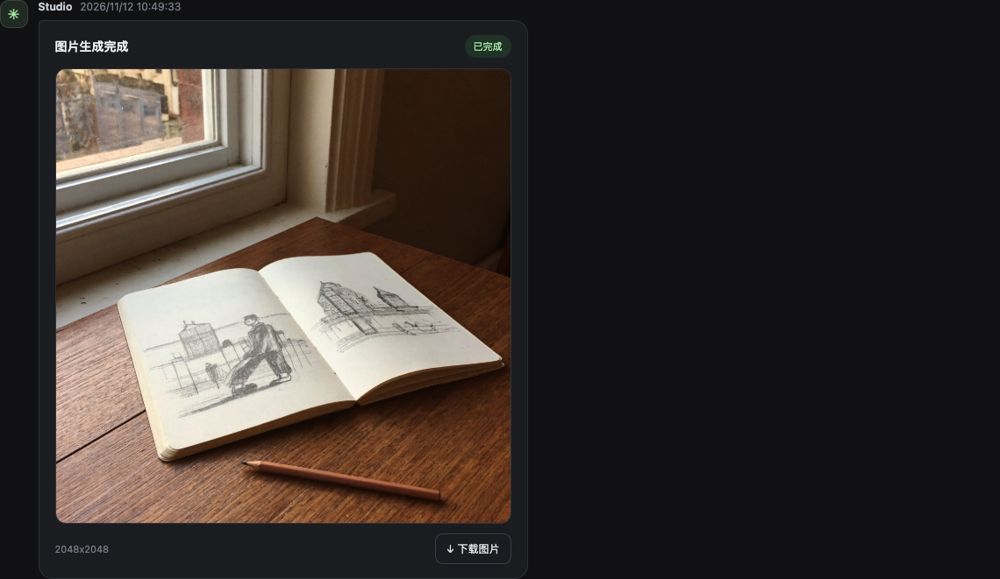

### RT-03 文生视频

- 任务：`aea54e0b367b49fd862571ed260465e4`。同一提示词只有这一条。
- 时间：10:48:40 提交，10:53:06 完成，约 4 分 26 秒。
- 提示词：验收镜头：湖面薄雾缓缓散开，远处是安静的山影，镜头缓慢向前推进。
- 模式：视频 · 文生视频。模型 `MiniMax-H3`，提供方 `comfyui_h3_video`。
- 结果：MP4，文件头为 `ftyp`，884,190 字节，608×352，时长 5.167 秒。素材 `1778248dbca24630a01cd5cac16354ab`。卡片为「视频生成完成 / 已完成」，标注「5 秒 · 文生视频」，进度在结尾，有「下载视频」。
- 提交前：


- 完成后：

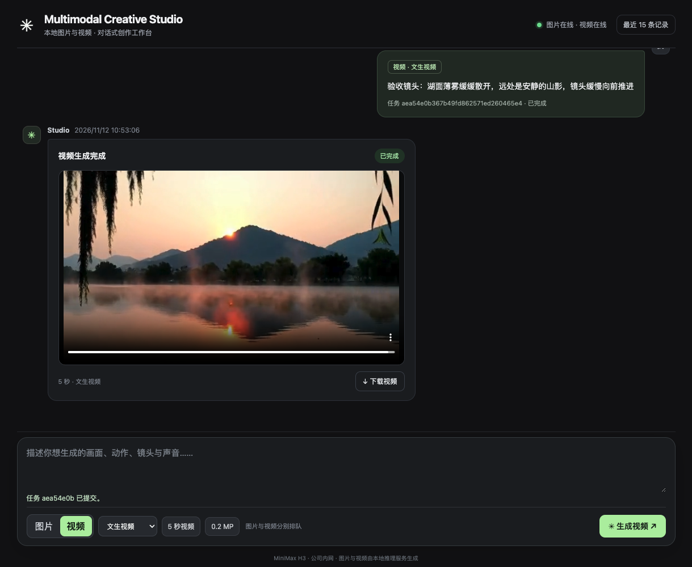

### RT-04 图生视频

- 任务：`fabe16d13ed8466e9a6f5b53eb74a01e`。同一提示词只有这一条。
- 时间：10:54:32 提交，10:59:08 完成，约 4 分 36 秒。
- 参考图：上面的 1024 茶杯图，文件名 `accept-1024.png`。
- 提示词：验收动作：茶杯留在木桌上，热气缓缓升起，镜头保持稳定。
- 结果：MP4，`ftyp`，347,318 字节，608×352，时长 5.167 秒。素材 `c566a1d3e5d64649befdaaebff1fdb07`。播放器显示 `0:05 / 0:05`，标注「5 秒 · 图生视频」，画面仍是这只茶杯。
- 提交前：

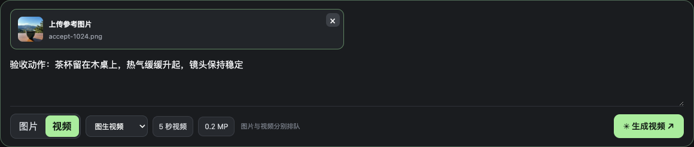

- 完成后：

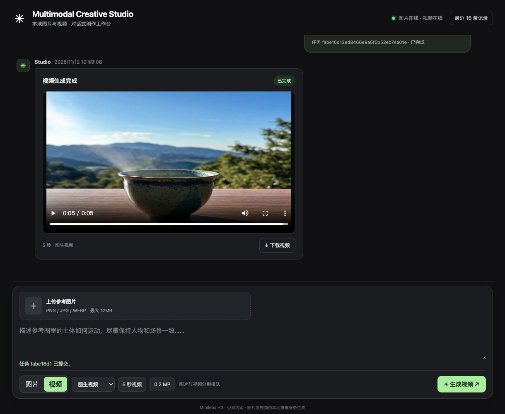

### RT-05 首末帧视频

- 任务：`6495c19e157e4f67968eb1690165970a`。同一提示词只有这一条。
- 时间：11:00:04 提交，11:04:56 完成，约 4 分 52 秒。
- 首帧：1024 茶杯图 `accept-1024.png`。末帧：2048 素描本图 `accept-2048.png`。
- 提示词：验收转场：画面从青色茶杯平滑过渡到窗边的素描本，镜头保持平稳。
- 结果：MP4，`ftyp`，508,116 字节，608×352，时长 5.167 秒。素材 `aaae5ce7c7ca49c9bcbd7f612a5fc270`。开头画面是茶杯，`0:00 / 0:05`；结尾画面是素描本，`0:05 / 0:05`。标注「5 秒 · 首末帧视频」。
- 提交前：

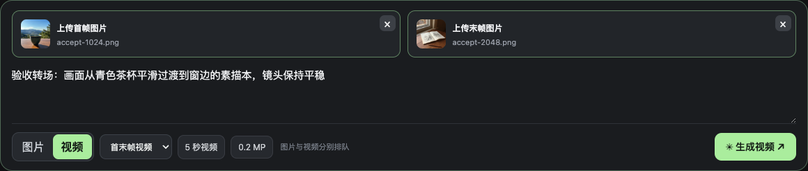

- 开头：

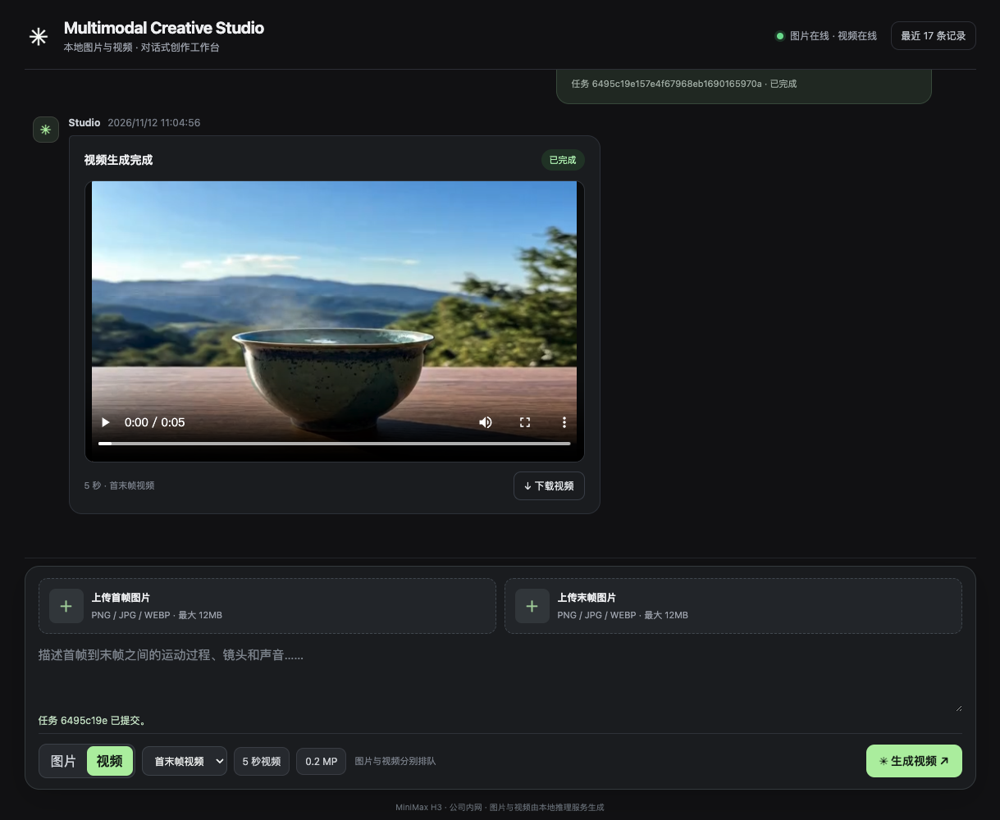

- 结尾：

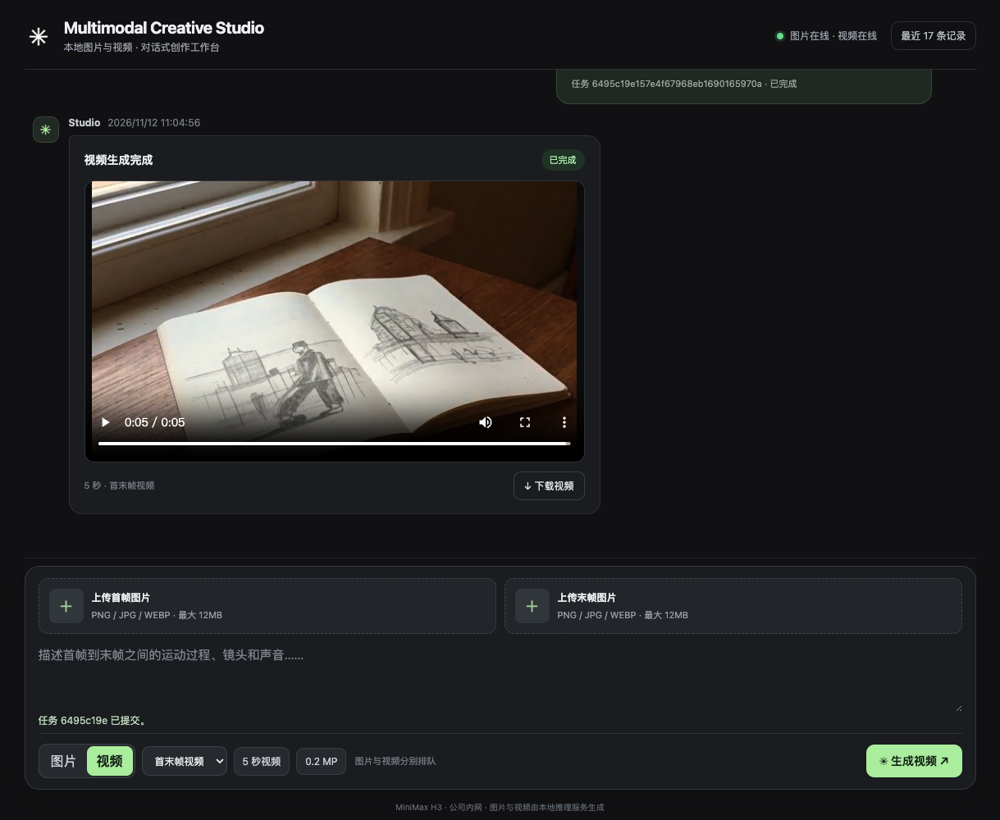

### RT-10 图片与视频同时排队

2048 文生图提交后，立刻又提交了文生视频。10:48 的页面上两条都是「生成中」：图片已运行 36 秒，视频已运行 10 秒。页头仍是「图片在线 · 视频在线」。视频提示下只写了「任务 aea54e0b 已提交」。两条后来各自完成，没有互相卡住。

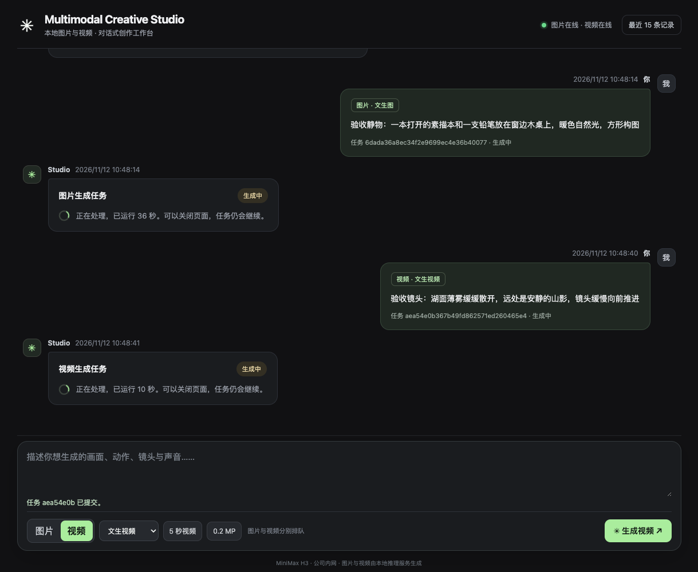

### RT-08 刷新后历史仍在

五条都完成后刷新 `http://192.168.10.104:8088/`。页面重新加载后仍显示「最近 17 条记录」和「图片在线 · 视频在线」。五条验收任务都还在，状态为已完成，预览和下载按钮都在：

| 任务 | 刷新后的卡片 |
|---|---|
| `2ec4089523da4a05919a091a50ad3f28` | 图片生成完成，1024x1024，下载图片 |
| `6dada36a8ec34f2e9699ec4e36b40077` | 图片生成完成，2048x2048，下载图片 |
| `aea54e0b367b49fd862571ed260465e4` | 视频生成完成，5 秒 · 文生视频，下载视频 |
| `fabe16d13ed8466e9a6f5b53eb74a01e` | 视频生成完成，5 秒 · 图生视频，下载视频 |
| `6495c19e157e4f67968eb1690165970a` | 视频生成完成，5 秒 · 首末帧视频，下载视频 |

刷新后的首末帧卡片仍能播放，并显示「已附首帧图和末帧图」：

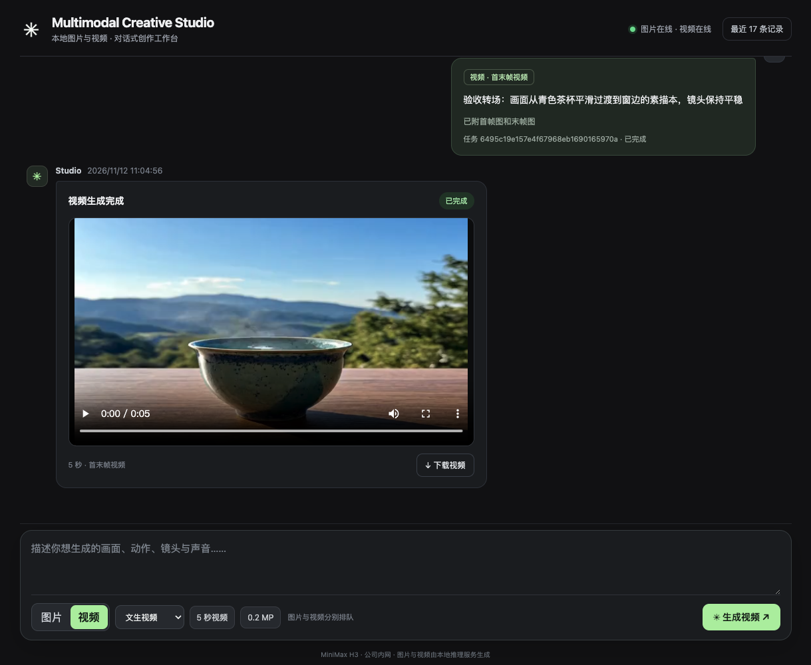

## 仍未做的项

1. 没有重启 104 上的 Studio 进程，所以「重启后素材是否还在」仍是 NOT RUN。刷新页面已经验证过。若以后要重启，只重启 Studio，不要动 8089、8189、8190。
2. 8089 仍按原部署单独运行。页面视频直接提交 8189，这次通过的视频不把 Native API 算成已接通。字段契约仍是 `VIDEO_NATIVE_CONTRACT_UNVERIFIED`。
